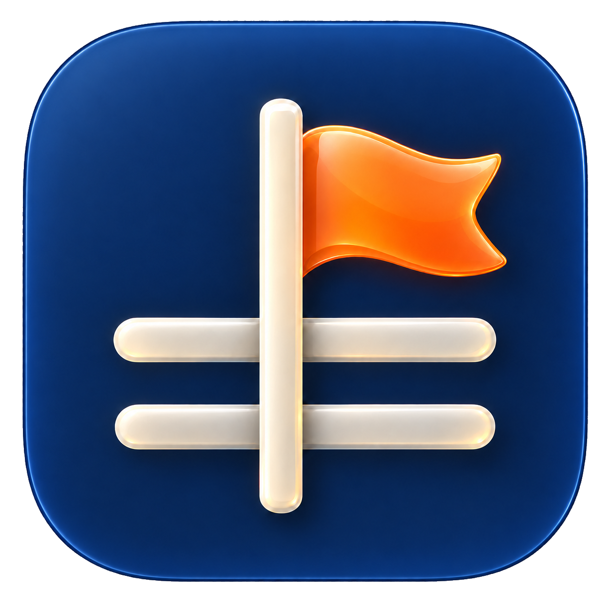

# YeahBouy



A compact native activity logger and to-do checklist, written in **Rust +
[GPUI Kit](https://gpui-kit.com)**. No Python, Qt, database, or backend service.

## Features

- A 380×480 menu-bar panel with shadcn-style dark components.
- Log activities with Enter or the **Add** button; optionally tag Development,
  Research, and Paperwork.
- Separate **Activity** and **To-do** tabs. Add tasks, check them off, reopen
  them, and delete them. Tasks persist across days and app restarts.
- Browse previous days and search the selected day.
- A **History** window with a calendar, buttons for days with logs, and access
  to the selected day's Markdown file.
- Choose a Markdown destination using **Folder**. Existing files stay in their
  original location; they are never automatically moved.
- macOS menu-bar integration through `tray-icon` and a small AppKit adapter.
  Windows and Linux use their native system tray and a compact utility window.
  Escape hides the macOS app or minimizes the Windows/Linux panel; the tray
  opens it again. Right-click the tray icon for Open and Quit.

Keyboard: Enter submits the focused input, **⌘/Ctrl+Enter** submits the current
tab, **⌘/Ctrl+F** searches the day, and **⌘/Ctrl+Q** quits. Checkboxes support
keyboard activation through GPUI Kit.

## All content is Markdown

Daily activities use the same format as earlier Python versions:

```markdown
# YeahBouy — 2026-07-21

## 2026-07-21 09:30:00
Review release checklist
#Development #Research
```

The persistent checklist is `todos.md` in the same folder:

```markdown
# YeahBouy — To-do

- [ ] Plan the next release
- [x] Review the interface
```

Rust saves an invisible `<!-- yeahbouy:id=… -->` comment after each task to keep
its identity stable. Keep those comments when editing, and give newly added
tasks their own lines; the app assigns IDs when saving. Unknown non-checklist
lines cause a visible error instead of being silently discarded. Failed saves
preserve the draft and the previous checklist.

Existing daily logs and Markdown checklists are read directly. If only a legacy
`todos.json` exists, it is migrated to Markdown; the JSON file is removed only
after the Markdown save succeeds. Markdown changes use atomic file replacement.

Default log folders:

```text
macOS:   ~/Library/Application Support/YeahBouy/logs
Windows: %APPDATA%/YeahBouy/logs
Linux:   $XDG_DATA_HOME/YeahBouy/logs
```

Linux falls back to `~/.local/share/YeahBouy/logs`. `YEAHBOUY_LOGS_DIR` overrides
the destination. The existing Python app's selected folder is recognized without
requiring Qt. New folder preferences are saved in `settings.md` in YeahBouy's
default user-data directory.

An iCloud Drive folder works as the selected destination. Synchronization is
handled by iCloud, not a custom sync engine; the Markdown files are also
accessible on an iPhone. Reopen the panel to reload external edits. Avoid
simultaneous edits from multiple apps while saving.

## Run

Install [Rust](https://rustup.rs/) and your platform's native build tools
(Xcode Command Line Tools on macOS, Visual Studio C++ Build Tools on Windows).
macOS application bundles target macOS 12 or newer.

```bash
cargo run --locked
```

On Debian/Ubuntu, install the native dependencies before building:

```bash
sudo apt-get install build-essential clang cmake pkg-config libasound2-dev libfontconfig1-dev libwayland-dev libxkbcommon-x11-dev libx11-xcb-dev libxcb-shape0-dev libxcb-xfixes0-dev libxcb-cursor-dev libvulkan-dev libglib2.0-dev
```

Linux needs a desktop tray host supporting StatusNotifierItem and a usable GPU
or software Vulkan adapter. GPUI Kit uses Metal on macOS and native GPU backends
on other desktop platforms. Windows/Linux builds are covered by the packaging
workflow; the rewrite has been locally exercised on macOS.

## Project structure

```text
crates/core/       Activities, checklist parsing, Markdown writes, preferences
crates/desktop/    GPUI Kit views, keyboard commands, tray integration
```

`yeahbouy-core` has no GPUI dependency. A future iOS interface can reuse it;
this project does not include an iOS app or speculative mobile scaffolding.

## Checks

```bash
cargo test --workspace --locked
cargo fmt --all --check
cargo clippy --workspace --all-targets --locked -- -D warnings
```

Tests cover Markdown compatibility, safe migration and saves, stable task IDs,
tray placement, and a headless GPUI Kit interaction flow that logs an activity,
adds/completes/deletes a task, protects malformed data, and checks compact layout.

## Build and package

```bash
cargo build --release --locked
bash scripts/package.sh
```

macOS: `dist/native/YeahBouy.app`. Windows/Linux: `dist/native/YeahBouy/`.
The macOS app is ad-hoc signed, not notarized; Control-click and choose **Open**
if needed.

The **Package app** workflow checks and builds Apple Silicon macOS, Intel macOS,
Windows, and Linux on pushes to `main`. Run it manually to build without
publishing, or push a date tag (`YYYY-MM-DD`, optionally `-N`) to publish a
release using `CHANGELOG.md` after all four builds pass.

UI icons use GPUI Kit's bundled [Lucide](https://lucide.dev) assets. App artwork
and the menu-bar icon are in `assets/`.
